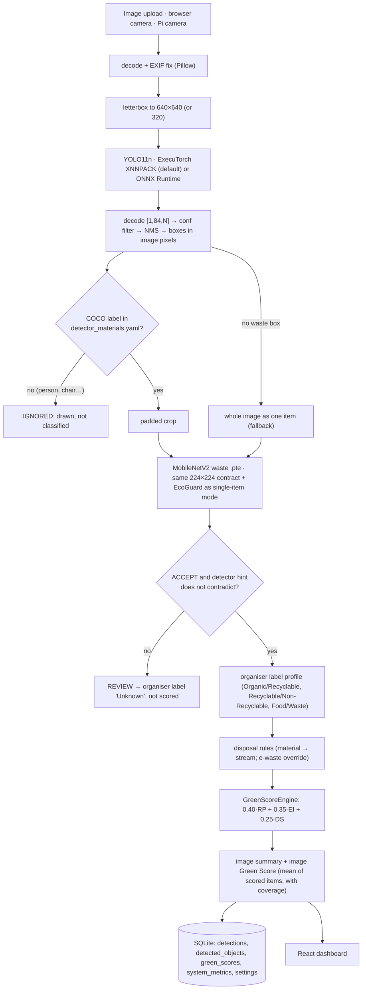

# Zyqora AI 4.0: architecture

## Pipeline (mixed-waste mode, `POST /api/detect`)

Single-item mode (`POST /api/classify`, alias of the 3.0 `/api/inference`) is unchanged: the whole image goes straight to MobileNetV2 + EcoGuard and may drive the (simulated) sorter. **Mixed-waste mode never actuates a bin**, because one photo can hold items for several bins.

## Why two models

| | YOLO11n (detector) | MobileNetV2 (classifier) |
|---|---|---|
| Knows | where objects are, 80 generic COCO classes | the organiser's waste classes (Organic / Recyclable) |
| Trained on | COCO 2017 (pretrained, not waste) | the organiser's waste dataset (team fine-tune) |
| Output used for | boxes, crops, a conservative *material hint* | the waste label of each crop |

Neither model alone solves the task: the classifier gives one label per photo, and the detector's labels are not waste categories ("bottle" does not say PET or glass; there is no "can" class). Combining them gives one waste label per object.

**Computational trade-off.** Latency = one detector pass + one classifier pass per waste crop (the `.pte` has a fixed batch of 1, so crops run sequentially). On the Raspberry Pi 5 (2 threads) that is 196.7 ms for YOLO11n-640 plus about 16 ms per crop; the full pipeline median is 224 ms on single-item photos (BENCHMARK_REPORT.md). `max_objects_classified` caps the worst case. YOLO at 320 px is 4.6× faster on the Pi (43.1 ms) but loses small objects (VOC bottle AP50 0.772 → 0.622).

**Honesty rules in code.** The COCO label is never shown as a waste category. Ambiguous classes map to material `Unknown`. A detector/classifier disagreement (e.g. "banana" classified Recyclable) becomes REVIEW. Electronics are routed to e-waste even when the classifier says Recyclable (the known Residual gap). REVIEW items are shown as `Unknown` and get no Green Score.

## Code map

| Path | Role |
|---|---|
| `src/zyqora/detection/yolo.py` | detector config, letterbox, ExecuTorch / ONNX runners, decode, NMS |
| `src/zyqora/detection/evaluate.py` | P / R / mAP@0.5 / mAP@0.5:0.95 (pycocotools 101-point AP) |
| `src/zyqora/mixed.py` | `MixedWastePipeline` (detect → crop → classify → rules → score), server-side annotation |
| `src/zyqora/wasterules.py` | label profiles, material table, `RecommendationEngine` |
| `src/zyqora/greenscore_engine.py` | `GreenScoreEngine` (formula, bands, explanations, aggregation) |
| `src/zyqora/api/mixed_service.py` | detector loading, settings overrides, persistence, metrics, benchmarks |
| `src/zyqora/api/detection_store.py` | SQLite schema + migrations for the 4.0 tables |
| `src/zyqora/api/app.py` | HTTP routes (API.md) |
| `frontend/src/pages/{Detect,Camera,GreenScoreEnv,Showcase}.tsx` | new dashboard pages |
| `config/detector.yaml`, `detector_materials.yaml`, `label_profiles.yaml`, `disposal_rules.yaml`, `greenscore_rules.yaml` | all rules are configuration |

Unchanged from 3.0 and reused: `zyqora.profiles` (classifier loading, SHA pin, contract checks), `zyqora.pipeline` (preprocess → ExecuTorch → decoder → EcoGuard), the `classifications` history, Green Points rewards, voice, camera and sorter.
