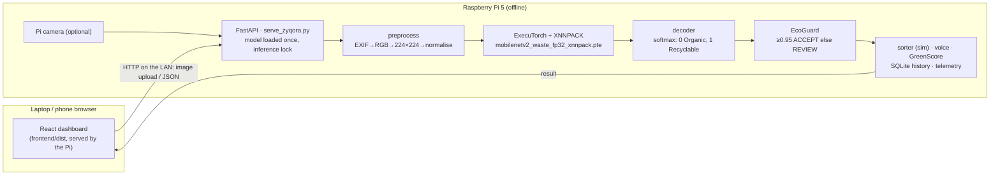

# Zyqora AI 4.0

**Offline mixed-waste detection, segregation guidance and Green Score on a Raspberry Pi 5.**
NAMMA AI hackathon, PS3 (AI for Sustainability: Edge-Based Waste Sorting). Target: Raspberry Pi 5, ExecuTorch, XNNPACK, fully offline.

> **Status in short** (details and the BLOCKED / UNVERIFIED list in [IMPLEMENTATION_STATUS.md](IMPLEMENTATION_STATUS.md)):
> - **4.0 adds mixed-waste analysis.** YOLO11n finds every object, and the team's MobileNetV2 (Organic / Recyclable) classifies each crop. Organiser label profiles, disposal rules and a transparent **Green Score** are then applied. Results go to SQLite and a React dashboard with 13 pages. See [ARCHITECTURE.md](ARCHITECTURE.md).
> - **The detector is the pretrained COCO YOLO11n, not a waste-trained detector.** It was chosen by measured held-out accuracy: VOC2007 test mAP@0.5 0.832, vs 0.813 for YOLOv8n ([DETECTION.md](DETECTION.md)). Its labels are used only as material hints. Waste-detection mAP and end-to-end mixed-waste accuracy are **not measured**: no box-annotated waste test set was available.
> - **Measured on the Raspberry Pi 5:** the classifier reproduces validation (**96.60%** vs 96.65% reported) at **12.7 ms median** with 2 threads.
> - **Measured on an x86 development host only:** detector and full-pipeline latency ([BENCHMARK_REPORT.md](BENCHMARK_REPORT.md)). Pi detector benchmarks are pending.
> - **Windows** scripts are provided (`setup_windows.ps1`, `start_all.ps1`) but **unverified on Windows** ([WINDOWS_SETUP.md](WINDOWS_SETUP.md)).
> - The classifier **cannot recognise Residual waste**. Electronics recognised by the detector are routed to e-waste ([MODEL_EVALUATION.md](MODEL_EVALUATION.md)).

## Zyqora AI 4.0 in one picture

```
photo ─► YOLO11n (ExecuTorch XNNPACK) ─► boxes ─► crop ─► MobileNetV2 waste .pte + EcoGuard
      ─► organiser label (profile) ─► disposal stream (rules) ─► Green Score (0.40·RP + 0.35·EI + 0.25·DS)
      ─► SQLite ─► dashboard: AI Detection · Live Camera · Green Score · Analytics · Model Comparison · History · Monitoring · Showcase
```
Unreliable items (low confidence, or detector/classifier disagreement) are shown as **Unknown** and are not scored. Mixed-waste mode never moves a bin. Docs:
- [ARCHITECTURE.md](ARCHITECTURE.md)
- [DETECTION.md](DETECTION.md) (YOLO, labels, datasets)
- [GREEN_SCORE.md](GREEN_SCORE.md)
- [DATABASE.md](DATABASE.md)
- [API.md](API.md)
- [WINDOWS_SETUP.md](WINDOWS_SETUP.md)
- [README_PI.md](README_PI.md) §17
- [HACKATHON_DEMO.md](HACKATHON_DEMO.md)
- [VIVA_QUESTIONS.md](VIVA_QUESTIONS.md)

### Windows laptop (PowerShell, in `Zyqora-main`)
```powershell
powershell -ExecutionPolicy Bypass -File .\setup_windows.ps1
```
```powershell
powershell -ExecutionPolicy Bypass -File .\start_all.ps1
```
This opens http://127.0.0.1:8000.

### Raspberry Pi 5
```bash
git pull && pip install -r requirements-pi.txt && (cd frontend && npm ci && npm run build) && bash scripts/start_pi_demo.sh
```

## 3.0 single-item dashboard (still included)

## Architecture



The laptop only displays the dashboard and uploads images; every prediction is computed by the API process on the device that serves the page. The API reuses the CLI's pipeline (`zyqora.profiles`, `zyqora.pipeline`), so the dashboard, `run_zyqora.py` and `zyqora_station.py` give identical results for the same image.

## Run the dashboard

**On the Raspberry Pi (judge demo).** Full steps in [README_PI.md](README_PI.md) §0 and §16.
```bash
cd /home/pi/Zyqora_Final/Zyqora-main && source .venv/bin/activate && pip install -r requirements-pi.txt
```
```bash
(cd frontend && npm ci && npm run build)
```
```bash
bash scripts/start_pi_demo.sh
```
Then open the printed `http://<pi-ip>:8000` in a browser on the same network. No Vite dev server is needed.

**On a laptop (development).** You need Node.js ≥ 20.19 (tested with Node 22) and Python 3.12.
- Frontend against the Pi:
  ```bash
  cd frontend && npm ci && ZYQORA_API_TARGET=http://<pi-ip>:8000 npm run dev
  ```
  Open http://localhost:5173. The dev server proxies `/api` to the Pi, so inference still happens on the Pi.
- Local backend: Linux, or macOS with the ExecuTorch 1.3.1 wheels (`pip install -r requirements-export.txt fastapi uvicorn python-multipart`):
  ```bash
  python serve_zyqora.py --profile waste_mobilenetv2
  ```
  then `npm run dev` in `frontend/`. Windows: ExecuTorch 1.3.1 publishes Windows wheels; use `setup_windows.ps1` (unverified, see WINDOWS_SETUP.md), or point the dev server at the Pi.

**Confirming the Pi runs the trained model (not the ImageNet one).** Check **Model Performance → Loaded model**, or:
```bash
curl -s http://<pi-ip>:8000/api/model/status
```
It must show `"profile": "waste_mobilenetv2"`, `"output_shape": [1, 2]`, `"classes": ["Organic", "Recyclable"]`, and a `sha256` equal to the hash printed on the Mac export. A wrong file under that profile is refused (`MODEL_CONTRACT_MISMATCH` / `MODEL_HASH_MISMATCH`), so the dashboard can't silently run the ImageNet model. API reference: [API.md](API.md). Demo script: [HACKATHON_DEMO.md](HACKATHON_DEMO.md).

## What it does

```
camera / image file
  └─► preprocess (Pillow + NumPy, bit-identical to TorchVision)
        └─► MobileNetV2 .pte on ExecuTorch + XNNPACK (loaded once, offline)
              └─► decoder for THIS model (2-class waste  |  1000-class ImageNet + MaterialWise)
                    └─► EcoGuard: ACCEPT (bin) or REVIEW (supervisor, no bin opened)
                          ├─► explanation card + VoiceSort (Tamil / English, offline clips)
                          ├─► sorter (simulation by default; GPIO only when explicitly enabled)
                          └─► GreenScore PENDING event ─► supervisor verification ─► points
```

| Component | Implemented as |
|---|---|
| **Model profiles** (`config/models.yaml`, `src/zyqora/profiles.py`) | Each `.pte` is bound to its own preprocessing contract and decoder. A model whose output shape doesn't match its profile is refused at load, so the 2-class decoder can never run on the ImageNet model (or vice versa). There is an optional SHA-256 pin, and fallback to the ImageNet baseline is explicit and logged. |
| **Waste decoder** (`src/zyqora/decoders.py`) | logits `[1, 2]` → softmax once → index 0 Organic → COMPOST, index 1 Recyclable → RECYCLE |
| **MaterialWise** (`src/zyqora/materialwise.py`) | ImageNet baseline only: editable rules from ImageNet classes to categories |
| **EcoGuard** (`src/zyqora/ecoguard.py`) | ACCEPT only if the category probability ≥ threshold (waste model: 0.95 provisional); otherwise REVIEW with a reason. REVIEW items keep their predicted category for evaluation but are **never sorted**. |
| **Explainability** (`src/zyqora/explain.py`) | Per-item card: class probability bars, the threshold, the EcoGuard decision in plain words, timings |
| **VoiceSort** (`src/zyqora/voicesort.py`) | Pre-generated Tamil and English WAV clips via `aplay`. If playback fails, the text is printed and the station keeps going. |
| **GreenScore** (`src/zyqora/greenscore.py`) | SQLite. Points are awarded only after a supervisor verifies the real bin; each event once (atomic); parameterised SQL. |
| **Camera** (`src/zyqora/camera.py`) | Picamera2 / `rpicam-still` / folder simulation; single shot per key press |
| **Sorter** (`src/zyqora/sorter.py`) | Simulation (default) or gpiozero pulses, which need config **and** `--enable-actuator` |
| **Evaluation** (`src/zyqora/evaluator.py`) | Accuracy, per-class precision/recall/F1, confusion matrix, accepted-only metrics, review rate, unsupported ground truth |

The contribution is the integration: offline edge inference + confidence-aware review + bilingual guidance + verify-to-earn rewards on a Pi. None of the individual techniques is claimed to be new.

## Models
| Profile | Model | Contract | Status |
|---|---|---|---|
| `waste_mobilenetv2` | MobileNetV2 fine-tuned on Organic vs Recyclable, FP32 `.pte` (8.47 MiB, committed) | exact 224×224 resize, ImageNet mean/std → `[1, 2]` | **Active.** Validation 96.65% (team) / 96.60% reproduced on the Pi. TEST pending. |
| `imagenet_mobilenetv2` | TorchVision MobileNetV2 IMAGENET1K_V1, FP32 `.pte` (13.99 MB) | resize 256 → crop 224 → `[1, 1000]` | Baseline / fallback |

Model details and the evaluation plan: [MODEL_EVALUATION.md](MODEL_EVALUATION.md). INT8 experiments with the ImageNet model: [MODEL_COMPARISON.md](MODEL_COMPARISON.md).

## Quick start
Tests run anywhere (Python ≥ 3.10; torch not required):
```bash
pip install -r requirements-dev.txt
```
```bash
python -m unittest discover -s tests -t . -v
```
Frontend checks (in `frontend/`):
```bash
npm run lint && npm run typecheck && npm test && npm run build
```
Raspberry Pi deployment: [README_PI.md](README_PI.md). Configuration: [CONFIGURATION.md](CONFIGURATION.md). Camera, actuator and audio: [HARDWARE.md](HARDWARE.md). API: [API.md](API.md). Demos: [HACKATHON_DEMO.md](HACKATHON_DEMO.md) (dashboard) and [DEMO.md](DEMO.md) (terminal station).

## Commands
| Task | Command |
|---|---|
| Dashboard + API (Pi, LAN) | `bash scripts/start_pi_demo.sh` or `python serve_zyqora.py --host 0.0.0.0 --port 8000` |
| Dashboard + API (Windows) | `powershell -ExecutionPolicy Bypass -File .\start_all.ps1` |
| Detector benchmark (+ full pipeline) | `python scripts/benchmark_detector.py --threads 2 4 --images <dir> --pipeline` |
| Detector evaluation (held-out boxes) | `python scripts/evaluate_detector.py --voc <VOC2007 dir>` or `--images <dir> --labels <dir> --dataset-classes classes.txt` |
| Detector export / parity | `python scripts/export_detector.py --weights yolo11n.pt --imgsz 640 320` · `python scripts/check_detector_parity.py --weights yolo11n.pt --images <dir>` |
| TACO waste-detector data / training (needs approval + GPU) | `python scripts/prepare_taco.py --taco <TACO/data> --out data/taco_yolo` · `python scripts/train_detector.py --data data/taco_yolo/data.yaml --confirm` |
| Database init / migrate | `python scripts/init_db.py` |
| Verify + activate the waste model (Pi) | `python scripts/verify_waste_model.py --images <VAL sample with O/ R/> --expected-sha256 <hash> --activate` |
| Station (simulation) | `python zyqora_station.py --camera folder:data/demo --voice ta --user DEMO01` |
| Station (Pi camera) | `python zyqora_station.py --camera auto --voice en --user DEMO01` |
| TEST evaluation | `python run_zyqora.py --profile waste_mobilenetv2 --images <TEST dir> --labels-from-folders --dataset-role test --quiet --out outputs/test_waste` |
| Organiser evaluation | `python run_zyqora.py --images data/organiser --labels data/organiser/labels.csv --dataset-role organiser --out outputs/final` |
| Leakage check | `python scripts/check_leakage.py --split train=<dir> --split val=<dir> --split test=<dir>` |
| Parity (waste model) | `python scripts/check_parity.py --images <dir> --contract config/model_waste.json --checkpoint <.pth> --pte models/mobilenetv2_waste_fp32_xnnpack.pte` |
| Re-export the waste model | `python scripts/export_fp32.py --checkpoint <.pth> --contract config/model_waste.json --out models/mobilenetv2_waste_fp32_xnnpack.pte` |
| Benchmark | `python scripts/benchmark_pi.py --profile waste_mobilenetv2 --threads 1 2 3 4 --images <dir>` |
| Threshold sweep (dev/val only) | `python scripts/sweep_threshold.py --results outputs/<dev run>/results.csv` |
| Config / offline checks | `python scripts/check_config.py` · `python scripts/check_offline.py` |
| Voice | `PYTHONPATH=src python -m zyqora.voicesort --lang ta --say RECYCLE` |
| GreenScore | `PYTHONPATH=src python -m zyqora.greenscore verify --event-id 3` · `... points --user-id DEMO01` |

`run_zyqora.py` exit codes: 0 ok, 2 config, 3 model/runtime, 4 data. `zyqora_station.py` also uses 5 for a camera error and 6 for an actuator error.

## Outputs
- `outputs/<run>/results.csv`: one row per image. Columns: `image_filename, ground_truth_category, raw_top1_class, raw_top1_probability, predicted_category, predicted_category_score, mapping_status, ecoguard_status, review_reason, disposal_action, inference_time_ms, correct`, plus supporting columns.
- `outputs/<run>/summary.json`:
  - accuracy, review rate, accepted-only accuracy, incorrect accepted
  - `metrics` (confusion matrix, per-class P/R/F1) and `accepted_only_metrics`
  - unsupported ground truth, latency, throughput, CPU per image, memory
  - model profile, SHA-256 and fallback flag, EcoGuard settings, platform, `evaluation_scope`
- `outputs/station/<run>/`: `events.jsonl`, `summary.json` (camera-to-result latency), `station.log`
- `outputs/web/`: dashboard history (`zyqora_web.sqlite3`), thumbnails, `server.log`

## Metric definitions
- **Overall accuracy** = correct predictions / **all** evaluated images. REVIEW, failed, and unsupported-truth (e.g. Residual) images all stay in the denominator.
- **Accepted-only accuracy** = correct ACCEPTed / ACCEPTed (reported as "undefined" if none were accepted). **Review rate** = REVIEW / all.
- Precision, recall and F1 are per ground-truth class over all images. The confusion matrix has a `<none>` column for failed images.
- Latency: model-only `forward()` time is reported separately from preprocessing and end-to-end time, after an untimed warm-up.

## Known limitations
- **Residual / unknown items** are forced into Organic or Recyclable, often with high confidence. EcoGuard cannot catch this. MODEL_EVALUATION.md lists the fixes.
- 0.95 is a validation-set operating point, not a guarantee. TEST results are pending.
- No Pi measurements and no physical camera, actuator or speaker tests yet.
- One item per image (no object detection).
- The dashboard has no login. Run it only on a trusted local network. The browser camera needs https or localhost; over plain http, use the Pi camera button or upload a file.
- The ExecuTorch wheel depends on torch, so the Pi environment is several hundred MB.
